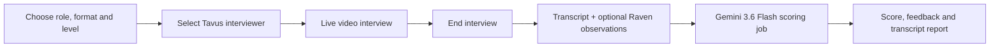
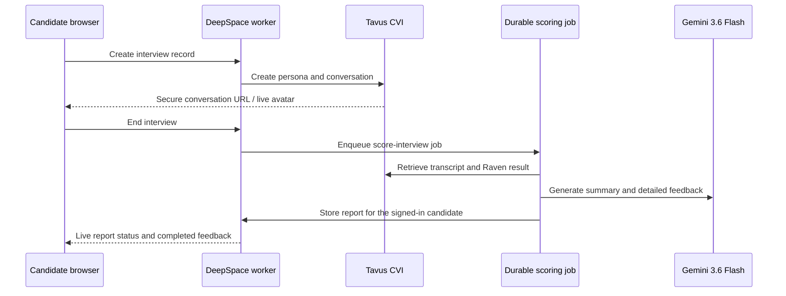

# Dialogue — AI Mock Interview Platform

[](https://dialogue-interview-neel.app.space)

Dialogue is a browser-based mock-interview platform for interview practice and coaching. A candidate selects a target role, interview format, seniority level, and optional job description; then practices with a live conversational video interviewer and receives structured feedback after the call.

**Live application:** [dialogue-interview-neel.app.space](https://dialogue-interview-neel.app.space)

## Product preview

### Live interview workspace


The interview stage combines the Dialogue controls with a Tavus conversational-video session. Candidates can speak naturally, use captions, and end the session when they are ready for feedback.

<p align="center">
  <a href="https://www.tavus.io/" title="Tavus">
    
  </a>
</p>

> The visual above is served from the [official Tavus website](https://www.tavus.io/) and remains Tavus property. It illustrates the conversational-video technology used by the project.

## Product flow



### What candidates can do

- Choose behavioral, coding, or system-design interview formats.
- Tailor an interview to a role, seniority level, and job description.
- Select a Tavus video interviewer avatar.
- Complete a real-time conversational video interview with follow-up questions.
- Review a score, answer-by-answer feedback, strengths, improvement areas, and transcript after the call.
- Return to prior interview reports from their personal history.

## Technology overview

| Layer | Responsibility |
| --- | --- |
| **React + Vite** | Candidate-facing interview setup, live-call stage, report view, and history UI. |
| **DeepSpace + Cloudflare Workers** | Authentication, real-time records, role-based access control, durable background jobs, and deployment. |
| **Tavus Conversational Video Interface** | Video interviewer replica, persona, conversation room, captions, and interview transcript. |
| **Tavus Raven** | Optional end-of-call camera and delivery observations used as coaching context. |
| **Gemini 3.6 Flash** | Server-side fast summary and detailed report generation from the completed interview transcript. |

## Architecture

### Why multimodal interview feedback matters


The architecture uses the transcript as the core evidence for scoring and can add Tavus Raven camera and delivery observations as limited coaching context. This helps preserve useful conversational signals without treating them as a hiring decision.



## Feedback model

The scoring job runs after the call ends. It waits for the Tavus transcript, then generates:

- an immediate headline score and short summary;
- a detailed per-question breakdown with suggested stronger answers;
- strengths and practical areas to improve;
- optional camera and delivery coaching when Tavus Raven returns an observation.

Raven observations are intentionally framed as limited, actionable coaching. They are not used to infer personality, health, protected traits, or hiring suitability. Dialogue is a practice tool and should not be used as an automated employment decision system.

## Self-deploy a separate copy

This repository includes the application and its deployment scripts. You need Node.js **22.15+**, npm, a [DeepSpace account](https://deep.space/), a Tavus API key with conversational-video access, and a Google Gemini API key that can use the model configured in [`src/jobs.ts`](./src/jobs.ts) and [`worker.ts`](./worker.ts). Provider plans, quotas, and charges are yours to manage. The app runs on DeepSpace/Cloudflare, not on your laptop after deployment.

1. Fork this repository to **your own GitHub account** if you want your GitHub fork to be the new app's source of record, then clone your fork. DeepSpace permanently records the selected GitHub remote on the first deploy. If you clone this repository directly, change the Git remote to one you control before that first deploy.
2. From the fresh clone, run:

   ```sh
   npm run setup:deploy -- my-unique-interview-app
   ```

   Pick a new lowercase name (2–63 characters, letters, digits, single hyphens). The script checks Node, installs the locked dependencies, opens DeepSpace login if needed, changes the app name in `wrangler.toml` and `src/constants.ts`, creates a **new app ID**, prompts privately for the two API keys, stores them in DeepSpace's production secrets store, and deploys to `https://my-unique-interview-app.app.space`. It will not reuse the original app's identity or data. Keep the terminal open for browser-based login.
3. Open the printed URL, sign up or log in, start a short test interview, and confirm that the report completes. Tavus and Gemini calls can incur provider usage. Commit the generated `wrangler.toml` and `src/constants.ts` changes to **your fork** so future checkouts target your own app.

The required server-side secret names are `TAVUS_API_KEY` and `GOOGLE_GENERATIVE_AI_API_KEY`. The setup script uses `deepspace secrets set ... --stdin`; it does not write their values to tracked files or command arguments. Never commit `.dev.vars`, tokens, or secrets. The app name and app ID are not credentials, but they identify the deployment target.

### Optional Tavus key pool

For accounts that are authorized to be used together, the backend can use up to ten Tavus keys. From a checkout targeting your app, run `npm run tavus:keys -- 10` (or a smaller number). The script privately prompts for each value and stores it as `TAVUS_API_KEY_1` through `TAVUS_API_KEY_10` in DeepSpace; then deploy again. The original `TAVUS_API_KEY` remains the fallback for interviews created before the pool was enabled. Key values are never stored in interview records or sent to the browser.

The per-app Tavus key-pool Durable Object tracks successful conversation starts and in-flight reservations. It chooses the slot with the fewest starts/reservations, so every available slot gets one turn before any gets a second, and stops assigning a slot after five starts or a provider-reported account/allowance failure. All operations for a given interview use its assigned key. The app owner can inspect counts (not credentials) at `GET /api/admin/tavus-pool` while signed in. These are **application-side counts**, not Tavus's authoritative minute balance; multiple keys from one Tavus account still share that account's allowance. The counters do not automatically reset: only add accounts and adjust capacity in line with Tavus's actual quota and your authorization.

To deploy later code changes from the same checkout, run:

```sh
npm run deploy:app
```

That script prints the target app before deploying. In the original maintainer checkout, it requires `npm run deploy:app -- --confirm-production` to avoid an accidental production deploy. Do **not** rerun the first-time setup command with a different name on an existing app; it refuses to repoint a checkout. For a second independent app, use a new clone. To rotate a provider key, run `npx deepspace@latest secrets set KEY --stdin`, enter the value via stdin, and redeploy. `npx deepspace@latest secrets list --only-names` shows which keys are set without displaying values.

### Use your own domain

The `*.app.space` URL works immediately. If you already own another domain, attach it after deployment:

```sh
npx deepspace@latest app domain attach interview.example.com --external
```

DeepSpace first returns a TXT ownership record to add at your registrar. After that propagates, run `npx deepspace@latest app domain verify interview.example.com`. Add any returned routing/certificate records, repeat `verify` until active, and check `npx deepspace@latest app domain status interview.example.com`. Domain purchase, DNS access, and propagation cannot be automated from this repository. See the [DeepSpace custom-domain guide](https://docs.deep.space/guides/custom-domains) for current steps.

### Optional local development

Local development is **not** required to keep a deployed app running. If you want it, first run the setup above or initialize your own app ID and secrets, then:

```sh
npx deepspace@latest auth login
npx deepspace@latest dev start
```

DeepSpace generates `.dev.vars` as a local cache of the secrets store; it is ignored by Git. Do not edit it as the source of production secrets. The currently deployed project is [dialogue-interview-neel.app.space](https://dialogue-interview-neel.app.space); its identity in the template exists only so maintainers can redeploy that original instance, and the first-time setup script replaces it for a copy.

## Repository notes

This repository contains the application source and its Git history. External platforms used by the application are credited above; their trademarks, media, and API services remain their respective owners.
